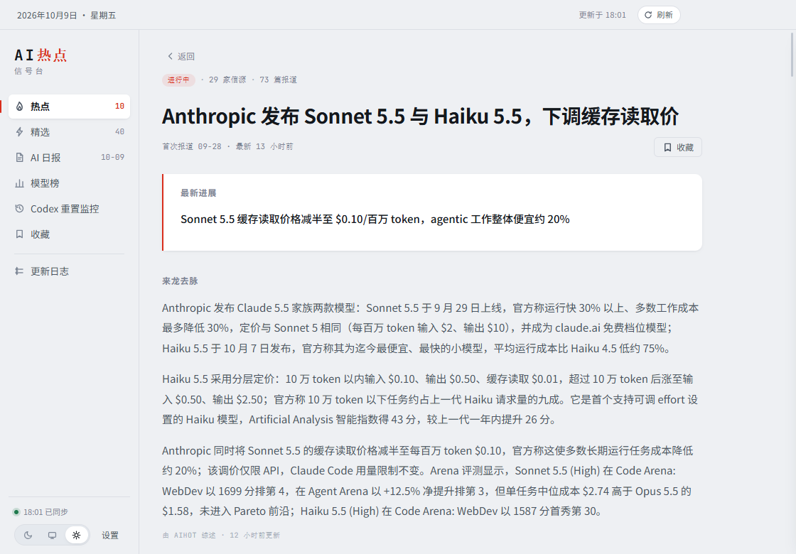
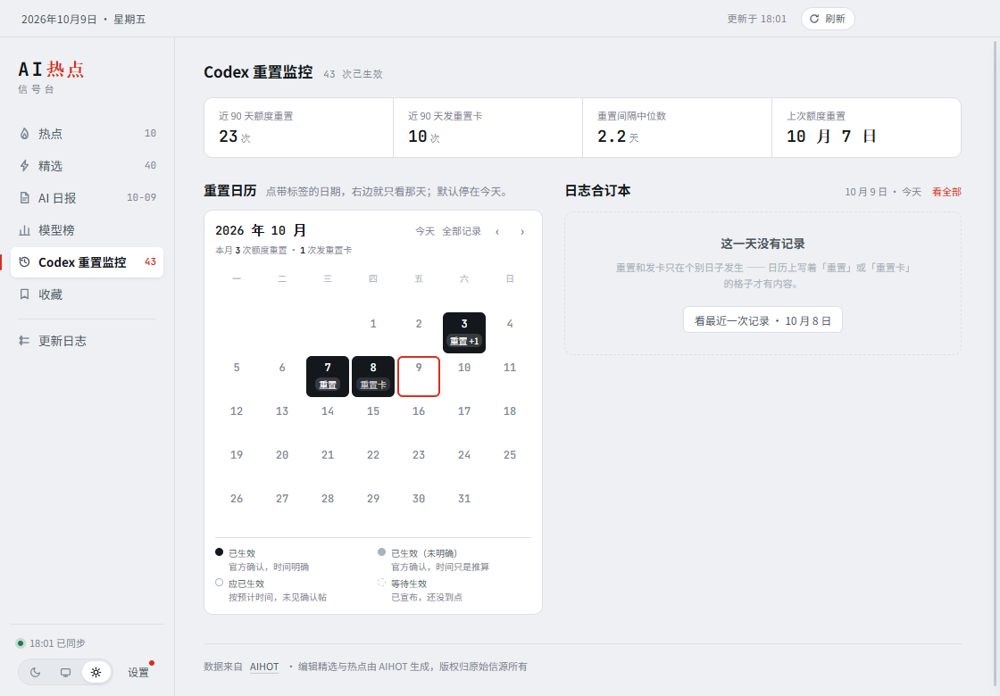
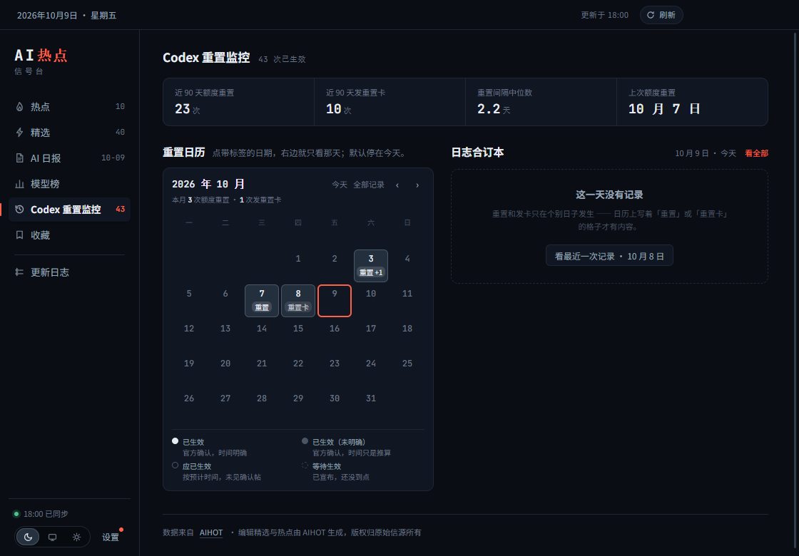
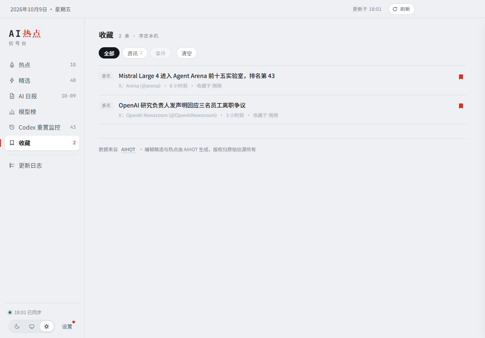

# AI 热点（aihot-desk）

托盘常驻的 AI 资讯监听台 —— 接收 [AIHOT](https://aihot.news) 的中文 AI 圈电讯。

| 浅色 | 深色 |
| -- | -- |
| 浅色 | 深色 |

## 七个档位

左侧常驻七个入口，每个对应 AIHOT 的一类数据。除了「更新日志」和「模型榜」  
（见各自说明），其余全部走官方公开只读接口。

### 热点 —— 当前最强的信号

按名次排列，每条可展开看传播计量（多少家信源在说、多少条信号、多少参与者），  
并直达原文 / AIHOT 阅读页 / 事件来龙去脉。

### 精选 —— 最近 7 天的编辑精选

可按模型 / 产品 / 行业 / 论文 / 观点过滤；带编辑评分与推荐理由。  
顶部有搜索框（同时搜精选与全部动态）和「编辑精选 / 全部动态」两种口径切换：

| 搜索（命中词高亮） | 全部动态 |
| --------- | ---- |
| 搜索        | 精选   |

### 事件页 —— 一条线读到底

从热点或精选里的「事件来龙去脉」进入（应用内打开，不跳浏览器）。  
一页里给出 AI 综述的最新进展、来龙去脉、按时间排列的全部报道，以及相关事件。



### 报告 —— 三个档位共用一张报纸

日报 / 周报 / 月报是同一件事的三个刻度：看某一段时间里发生了什么。所以三档共用  
一套三栏骨架（往期合订 / 版面 / 目录），换的只是中间那一栏问的问题。

**日报**（每天一期、一期十来条）问"今天有多少条"。往期栏按自然月折叠，默认只  
展开正在看的这个月 —— 100 期全铺开是一列读不完的流水账。

| 日报 | 分栏与条目 |
| -- | ----- |
| 日报 | 分栏    |

刊头右边那块日期牌不写「第 N 期」：日报接口里没有期号字段，用日期硬推只要中间  
停更一次就会偏。改成回答"这个月出到哪天了"—— 本月期数 + 一张发行点阵，哪几天  
有报一眼看得完。

**周报 / 月报**问"这一期讲了什么"，所以多一块刊头徽记、一段本期导读，正文的每个  
分栏也带一句综述（刊物才有的东西 —— 日报每天一期，来不及写）。往期一共才十几期，  
不再折叠，一行就是"第几期 + 从哪天起 + 那一期的标题"。

| 周报 | 月报 |
| -- | -- |
| 周报 | 月报 |

刊头右边那块**期号徽记**答的是"第几期 / 全年几期 / 一年出到哪一期的刻度"。期号的  
口径是从 AIHOT 页面里那份序列化数据核出来的：周报 2026-W19 → 1 …… W40 → 22，  
月报 2026-05 → 1 …… 2026-09 → 5 —— 按年、从最早一期起算，不是 ISO 周次，也不是  
"最新的算第 1 期"。开放接口没有这个字段，序号只能拿归档列表自己数，**所以归档  
必须拉满**（`REPORT_LIMIT` 里周报月报都是 60，接口上限）。早先只拉 12 期时，刊头  
上印的是「第 12 期 / 全年 12 期」—— 页面上完全看不出来是错的。

头条那张配图没有跟过来。站上图的地址是服务端渲染时才签发的（带签名与有效期），  
原图所在的 `storage.googleapis.com` 直连 403、`deepmind.google` 超时，站上的 OG  
分享卡又印着 AIHOT 的招牌 —— 三条路都不通。所以不摆一张假图，用期号徽记顶上，  
和日报的发行点阵是同一套语言：**拿真实的发行记录当装饰**。

三档的右栏两块都是**从数据里算出来的**：各栏目头条 = 每个分栏打头的那一条；  
本期版面 = 各分栏的条数。AIHOT 页上那个「今日看点」是编辑挑的，开放接口没有  
这个字段，所以不冒充它 —— 宁可少一块，不编一块。

统计行的口径也说清楚：第二项「家信源」是去重后的信源**名**，站上那一格印的是  
「133 条精选」（要按窗口统计精选条目数，而 `items` 接口的窗口只给 7 天、没有  
分页，拿不到）；第三项「N 期日报」的数值是**这一期覆盖的天数** —— 日报归档实测  
100 期从 2026-07-02 到 2026-10-09 一天不落，所以天数和期数相等。

顶部那排档位切换在**所有档位**下都在，视图头标题也跟着档位走（侧栏那一项叫  
「AI 日报」，进了周报就该写「AI 周报」）。

### 模型榜 —— 五个榜共用一张表

| 浅色  | 深色     |
| --- | ------ |
| 模型榜 | 模型榜·深色 |

综合 / 编程 / 科研 / 专业办公 / 知识问答五个榜，切换靠顶部那排 pill。  
五个榜**共用同一张八列表**（名次 / 模型 / 上线日期 / 评测证据 / 缓存价格 /  
输入价格 / 输出价格 / AIHOT 评分）—— 所以换榜不用换表头，视线不会跳。  
整行是一个按钮，点开就是站上那个模型的详情页。

**这一档和更新日志是同一类：没有 JSON 接口。** `/api/v1/models`、  
`/api/v1/leaderboard`、`/api/v1/rankings` 一类端点全部 404，只能解析  
`/leaderboard` 这个完整服务端渲染的页面（五个榜 = 五条路径，形状一样）。  
所以它和更新日志共用一套更保守的取数策略：结果缓存 30 分钟、失败后 5 分钟内  
不再重试、并发请求合流成一次、**按榜各自缓存**（切回看过的榜不发请求）。

写解析器时踩到一个只有真实页面才能发现的坑：HTML 里相邻单元格之间**只有标签、  
没有空白**，直接拍平会让两格粘成一个数 —— 上线日期 `2026-09-22` 和评测项数  
`33 项评测` 会粘成 `2026-09-2233 项评测`，那条正则就读出了 `2233`。  
所以拍平**之前**先把 `</td>` / `</th>` 换成空格（见 `shared/leaderboard.ts`）。

| 切到编程榜 | 深浅两色下都零裁切 |
| ----- | --------- |
| 编程榜   | 编程榜·深色    |

表格最怕的是"某一列被顶出框"：溢出的那截会被 `overflow: hidden` 裁掉，而裁掉的  
正好是数字列的尾巴，截图上看不出来。所以冒烟自检里**逐格问一遍**每个单元格和表体  
自己的 `scrollWidth - clientWidth`（`view-leaderboard-fit.json` 的 `clipped`  
必须为空、`tableOverflow` 必须为 0）。

底部那一块「暂不排名」照抄站上的口径 —— 一屏最多 30 个，**没在表里不等于排在后面**。  
这句话得写出来，不然那 5 个模型看起来像是"排在第 31 名往后"。

### Codex 重置 —— 额度重置事件



这条线最要紧的一件事：**"说了要发"和"确实发了"必须一眼能分开**。把预告当既成  
事实展示，用户会白等一晚上额度到账。所以整页共用一套四档状态记号：

| 状态       | 含义          | 记号           |
| -------- | ----------- | ------------ |
| 已生效      | 官方确认，时间明确   | 实心点 · 格子深底   |
| 已生效（未明确） | 官方确认，时间只是推算 | 实灰点 · 格子灰底   |
| 应已生效     | 按预计时间，未见确认帖 | 空心点 · 格子画虚线框 |
| 等待生效     | 已宣布，还没到点    | 虚线圈 · 格子空框   |

它出现在三个地方：日历格子的底色、图例、日志卡片左侧那道竖条。

**状态不用颜色区分，用墨的深浅** —— 全站只有一个彩色（信号红），留给"今天在看  
哪一天"。日历上一个月有十来个有记录的日子，全上彩色会糊成背景噪音；而"实不实"  
本身就是深浅的隐喻，不需要第二个颜色。深浅在两种主题下方向不同：浅色靠"最深的  
墨"，深色靠"比卡面亮一档 + 一道亮边"（`--cal-fill` 三个变量，见 tokens.css）。

顶上一排四个读数的口径，是拿 AIHOT 监控页上印着的数字逐条反推核对过的  
（23 次 / 10 次 / 2.2 天 / 10月7日 四项全中），不是想当然定的：

- 90 天窗口 = `today-89 ~ today`，以**服务端的当天**为准
- 只数"已落地"的那三档，等待生效的不算 —— 那是把预告当既成事实
- 相邻间隔按**精确时刻**算中位数，不是把日期归一后算整天（2.2 天 vs 2.0 天）
- 「上次额度重置」不受 90 天窗口限制，它就是最近一次

日历格子里那枚徽标只写「重置 / 重置卡」—— 格宽 48px，「额度重置」四个字加数量  
就撑出去了。完整说法挂在 `title` 上，鼠标停一下就补全。同一天有多条时按  
AIHOT 的口径折成 `+N`。

**打开这一页默认只看"今天"，不是把全部记录铺开。** 这一页要回答的问题是  
"现在额度是什么状态"，而答案在最近这一次记录里 —— 40 多张卡片从头铺到尾，  
最近的那张反而要往下找。所以日历旁边那块牌子上写的是焦点是哪天，旁边留一个  
「看全部」当出口。焦点分三种情形：

| 情形              | 右边的牌子              | 右边的正文 |
| --------------- | ------------------ | ----- |
| 刚打开（还没动过）       | `10 月 9 日 · 今天`    | 只看今天  |
| 点过某一天 / 翻月后落到某天 | `10 月 3 日`         | 只看那天  |
| 点过「看全部」         | `全部 43 条` + 「今天」按钮 | 全部记录  |

**默认这个态跟着服务端的"今天"走，不是本机日期** —— 数据是服务端按它自己的  
当天算的，两边差一天的时候（跨零点、时区）跟着数据走才不会出现"今天是空的"。  
真赶上那天没有记录，页面不会给你一页空白：给一句「这一天没有记录」，下面挂一个  
「看最近一次记录 · 10 月 8 日」的近路（`view-codex-default.json` 就是盯这个的）。

这也是"日历和合订本必须是同一个『天』"的探针：点日历上有记录的那天，右边就只看  
那天的记录；再点一次或点「今天」回到默认。翻到别的月份时，焦点会跟着带到那个月  
最近有记录的一天，日历下方那行「本月 N 次…」同时换成那个月的读数。

深色主题下四档的"实"换成"比卡面亮一档 + 一道亮边"，而不是一片亮白格子：



### 收藏 —— 只存在本机

任何一条资讯（精选条目、热榜条目、报告正文里的条目、事件里的单篇报道）都能收藏，  
事件本身也能收藏。**数据只写在本机的 `saved.json`，不上传、不同步、不联网。**

存的是**内容快照**而不是 id 引用 —— 精选集合会滚动，按 id 回查早晚会 404。  
收藏夹里按「资讯 / 事件」筛选，可以逐条移除，也可以一次清空（清空有二次确认）。



### 更新日志 —— AIHOT 这个服务本身变了什么

独立于资讯的一档：AIHOT 自己的功能更新、优化与下线记录，按日期倒序。

| 浅色   | 深色      |
| ---- | ------- |
| 更新日志 | 更新日志·深色 |

**这一页最要紧的一句话写在页面最上面**：这里记的是数据来源站点 AIHOT 自己的  
功能变更，**不是本应用的更新日志** —— 本应用自己的版本记录在左下角「设置」里。  
两件事都叫"更新日志"，不写明的话，看到「支持了 OAuth」会以为是这个应用加了登录。  
（它和上面那些资讯档位是两回事：资讯讲的是 AI 圈发生了什么，这一页讲的是  
"我们看的这个数据源本身改了什么"。）

版式是两栏：左边按日期倒序铺条目，右边三张卡 —— 按类型看（全部 / 更新 /  
优化 / 公告 / 下线，带条数）、按月份看、以及「有想法或遇到问题」通到 AIHOT  
的反馈页。两把索引是**筛**不是跳，而且可以叠加：选了「优化」再选月份，就是  
那个月的优化。筛空了给一句明确的空态，不留一页白。

| 按类型筛   | 特稿     |
| ------ | ------ |
| 更新日志筛选 | 更新日志特稿 |

索引上那几个数字是和站上核过的：`全部 81 = 更新 36 + 优化 37 + 公告 7 + 下线 1`。  
这里有一处**差一条在页面上几乎看不出来**的坑：站上"下线"那个圆点的类名是  
`bg-ink-4`，而解析器原来只认 `bg-[a-z-]+`（不带数字），抓不到就兜底成"更新" ——  
于是「下线 1」变成「更新 37」，总数照样对得上。所以解析器改成了 `bg-[a-z0-9-]+`，  
冒烟自检里也直接断言四档之和等于总条数。

特稿是整份日志里唯一一种长得不一样的条目：一整天的重点是一篇长文（截图里那天的  
AIHOT 2.0），只取标题、导语和小节目录，换一张带信号红脊线的卡片装，末尾给出  
「读全文」的出口。**解析器认不出结构时会直接显示"暂时读不出来"**，  
而不是拿半截脏数据糊弄 —— 认不出来永远比认错好。

## 其它行为

- 关闭窗口不退出，应用缩进托盘继续监听；托盘 tooltip 显示当前热榜第一条。
- 新事件进入热榜前三时可选发系统通知（默认关，设置里开）。
- 浅色 / 深色 / 跟随系统；窗口位置与尺寸会被记住。
- **自动更新** —— 每天自动检查一次新版本（可在设置里关）。发现新版本后  
  需要你点「下载」，下载完再点「重启并安装」；下载与安装从不自动发生。

## 数据来源与使用条款

数据来自 AIHOT 的公开只读接口（`https://aihot.news/api/v1`）：  
`items`（精选流 / 全部动态，支持分类、关键词搜索）、`hot-topics`、  
`stories/{id}`（事件）、`dailies` / `weeklies` / `monthlies`（报告）、  
`codex-resets`。

**两处例外：更新日志与模型榜。** `/api/v1/changelog`、`/api/v1/models`、  
`/api/v1/leaderboard`、`/api/v1/rankings` 这些端点都不存在（官方 OpenAPI 定义  
与 MCP 工具列表里都没有），只有 `/changelog` 和 `/leaderboard` 这两个完整服务端  
渲染的页面。所以这两档的数据是解析页面得到的，没有官方契约保障 ——  
改版就会失效，失效时界面会降级提示，不会崩。

按 AIHOT 的条款，个人非商业、公益非商业与组织内部使用免费；  
任何面向外部的商业产品、收费服务、客户交付、代理接口、数据转售、公开镜像或批量公开再分发，  
都须事先取得 AIHOT 书面授权（见 <https://aihot.news/terms>）。  
标题、摘要与综述来自第三方信源，版权归原始信源所有。

接口礼貌约束（客户端已实现，改动取数逻辑时别破坏）：

同一地址的轮询间隔不低于响应的 `Cache-Control` 所声明的 60 秒；  
每次都带 `If-None-Match`（未变化时服务端回 304 空体）；  
429 / 503 按 `Retry-After` 退避且不并行重试。  
更新日志和模型榜这两档额外做了一层：结果缓存 30 分钟、失败后 5 分钟内不再重试、  
并发请求合流成一次 —— 它们抓的是 HTML，比 JSON 接口重得多。模型榜还**按榜各自  
缓存**（五个榜就是五份 HTML），切回看过的榜不会重新抓。

## 开发

```bash
pnpm install          # 依赖（electron 二进制若缺失，见下方"离线装 electron"）
pnpm dev              # 开发模式（HMR）
pnpm typecheck        # 类型检查 —— 提交前必跑，build 不做类型校验
pnpm test:core        # 纯逻辑测试（295 项：信号量化 / 时间 / 版本比较 / 报告规范化与
                      #   期号统计 / 收藏 / 更新日志解析与分档统计 / 模型榜解析 /
                      #   链接识别 / Codex 事件）
pnpm build            # 构建到 out/
pnpm dist             # 打 Windows 安装包到 release/
```

启动已构建的版本：

```bash
./node_modules/electron/dist/electron.exe .
```

**离线装 electron**：`node_modules/electron/` 下如果没有 `dist/` 和 `path.txt`，  
说明二进制没下来。最快的办法是从同机另一个同版本（43.3.0）的 electron 项目里复制这两样：

```bash
cp -r <别的项目>/node_modules/electron/dist  node_modules/electron/dist
cp    <别的项目>/node_modules/electron/path.txt node_modules/electron/path.txt
```

## 发版与更新机制

应用内的更新走 electron-updater：打包时生成的 `resources/app-update.yml`  
（来自 `electron-builder.yml` 的 `publish` 配置）告诉它去哪个仓库查版本；  
运行时它去拉 Release 上的 `latest.yml` 比对版本，再按需下载差分包（blockmap）。

**一次完整发版**（改版本号 → 提交 → 打 tag，CI 自动出包并发 Release）：

```bash
# 1. 改 package.json 的 version（例如 0.2.0 → 0.3.0）
git add -A && git commit -m "release: v0.3.0"
git push
git tag v0.3.0 && git push origin v0.3.0
```

CI（`.github/workflows/release.yml`）在 Windows runner 上跑 typecheck + test:core + 打包，  
把 `*-setup.exe`、`*-portable.exe`、`latest.yml`、`*.blockmap` 一起传上 Release ——  
**缺了 `latest.yml` 或 blockmap，应用内检查更新会永远报「找不到版本信息」**。

**哪些形态支持自动更新**：

| 形态             | 自动更新                             |
| -------------- | -------------------------------- |
| NSIS 安装版       | ✅ 完整支持                           |
| 免安装版（portable） | ❌ 没有稳定的安装目录可覆盖，界面只提供「打开发布页」      |
| 开发模式           | ❌ 没有 app-update.yml，界面显示「打包后才生效」 |

**本地验证更新界面**（不联网，用注入的假版本驱动整个流程）：

```bash
AIHOT_DESK_FAKE_UPDATE=9.9.9 pnpm dev
```

跑冒烟自检时默认就会注入 `9.9.9`，并额外截下「发现新版本」与「已就绪」两张图：

| 发现新版本 | 下载完成，待重启安装 |
| ----- | ---------- |
| 发现新版本 | 更新就绪       |

## 架构

```
src/
├── main/         主进程：API 客户端、窗口、托盘、设置、收藏落盘、更新调度
│   ├── aihot.ts      AIHOT JSON 接口客户端（每 URL 缓存 + ETag/304 + Retry-After 退避）
│   ├── changelog.ts  更新日志抓取 + 解析（HTML，另一套缓存策略）
│   ├── leaderboard.ts 模型榜抓取（五个榜各一份缓存，其余同上）
│   ├── saved.ts      收藏落盘（tmp + fsync + rename 原子写，最多 500 条）
│   ├── tray.ts       托盘菜单与 tooltip
│   ├── updater.ts    electron-updater 的封装（检查/下载/安装三段式）
│   └── settings.ts   设置持久化（原子替换写入）
├── preload/      contextBridge 桥（只暴露显式列出的能力，没有通用 invoke）
├── shared/       主进程与渲染层共用：类型、格式化、纯逻辑（可无头单测）
│   ├── signal.ts     信号量化（8 格刻度）
│   ├── report.ts     三种报告 → 统一形状；统计行、期号、头条、看点
│   ├── codex.ts      Codex 事件规范化
│   ├── saved.ts      收藏条目构造与排序
│   ├── html.ts       两个解析器共用的 HTML 拍平（实体解码 / 去标签 / 收空白）
│   ├── changelog.ts  更新日志 HTML 解析 + 类型 / 月份统计
│   ├── leaderboard.ts 模型榜 HTML 解析（五个榜共用一套行形状）
│   ├── links.ts      站内链接 → id
│   ├── update.ts     版本比较（semver 数值比较，不是字符串比较）
│   └── format.ts     相对时间、期号、日期标签
└── renderer/     React 界面：tokens.css 设计令牌 + styles.css + 组件
```

设计上的四个约定：

1. **强调色纪律** —— 全站只有一个彩色 `--signal`（信号红），只出现在"这里有信号"的地方  
   （当前导航、热榜前三、信号带的点亮格、关键动作）。错误与中断用琥珀色，不占红色。
2. **信号带** —— 8 格固定刻度，是全应用唯一的签名元素。  
   热榜按信源数量、精选按编辑评分，回答的都是"这条有多强"。
3. **纯日期字符串不走 `Date` 解析** —— `new Date('2026-10-09')` 会按 UTC 零点算，  
   换个时区就显示成前一天。日期标签一律走 `shared/format.ts` 里的字符串处理。
4. **要分档的记号用墨的深浅，不用颜色** —— 日历上的四档状态、更新日志里的条目类型，  
   都是靠填充程度和边框说话。理由有两条：颜色已经被信号红征用了；而且"实 / 虚"  
   本身就是深浅的隐喻，多一个颜色只是多一层要记的对照表。  
   注意深浅在两种主题下方向是反的，所以这类填充色要单独立语义变量  
   （如 `--cal-fill`），不能直接复用墨阶。


## 冒烟自检

```powershell
Remove-Item Env:ELECTRON_RUN_AS_NODE
$env:AIHOT_DESK_SMOKE='1'; $env:AIHOT_DESK_SMOKE_EXIT='1'
$env:AIHOT_DESK_SMOKE_THEME='dark'   # 可选，强制主题
.\node_modules\electron\dist\electron.exe . --user-data-dir="$env:TEMP\aihot-desk-smoke-userdata"
```

三个坑，都是踩过的：

- **`--user-data-dir` 不是可选项**。应用有单实例锁，而锁是按用户数据目录算的 ——  
  不换目录的话，只要你自己开着一份 aihot-desk，自检进程会当场退出、只留下一个  
  `boot.json`，看起来像"跑起来了但什么都没写"。
- **别用 `&` 等它**。Windows 上 `& electron.exe .` 会立刻返回（GUI 子系统进程），  
  工具调用一结束整棵进程树就被拆掉。用 `Start-Process` 起，然后**循环等  
  `done.json` 出现**再判定结束。
- **浅色深色不要同时跑**。结论都写同一个 `%TEMP%\aihot-desk-smoke\`，并发会互相  
  覆盖，看到的是一堆随机缺失的文件。跑完一轮先拷走再跑下一轮。

结论写在 `%TEMP%\aihot-desk-smoke\`：

| 文件                                 | 看什么                                                                                                                                          |
| ---------------------------------- | -------------------------------------------------------------------------------------------------------------------------------------------- |
| `window.json`                      | 窗口几何 —— `contentBounds` 必须等于 `bounds`，否则说明原生菜单栏压着自绘标题栏                                                                                       |
| `tray.json`                        | 托盘图标是否为空图（载入失败不抛异常，只表现为"托盘里什么都看不见"）                                                                                                          |
| `snapshot.json`                    | 首屏取数结果（热榜前三条、各档条数）                                                                                                                           |
| `view-*.json`                      | 每个档位的 DOM 事实：标题、行数、期号数、报告分栏数、收藏行数、收藏按钮数                                                                                                      |
| `view-report-daily.json`           | 报纸版式的条数，以及 `.paper` 与三栏各自的 `scrollWidth - clientWidth`（必须为 0 —— 三栏是按 168 / 1fr / 188 定死的，谁都不许被内容顶宽）。溢出时 `paperCols[].over` 会指出是哪一栏、哪几个子孙撑出去的 |
| `view-report-weekly-board.json`    | 期号徽记那几个数是**自己数出来的**，页面上看不出对错，所以直接对：刻度数 = 全年期数 = 往期栏行数，且最后一格是当前这一期（周报 22 / 月报 5）                                                              |
| `view-report-archive.json`         | 日报往期默认只展开一个月（`openMonths` 长度必须为 1）；点第二期后版头日期要跟着变                                                                                             |
| `view-codex-fit.json`              | 日历最挤的地方：徽标的 `scrollWidth - clientWidth` 必须为 0（第 48px 宽的格子里塞「重置卡 +1」），以及今天那格有没有环                                                              |
| `view-codex-default.json`          | **刚打开时不该是"全部记录"** —— `focus` 必须是「… · 今天」、`empty` 必须是那一句空态、`emptyGo` 要指到最近一次记录                                                                |
| `view-codex-pick-after.json`       | 点了日期之后剩下的卡片数、`focus` 是不是那一天、`pickedBg` 必须等于 `--signal` 的 RGB（类挂上了但被同特异性的规则盖掉，是 CSS 里最难看出的一种错）                                                |
| `view-leaderboard-fit.json`        | 表格最怕"某列被顶出框"，所以逐格查 `scrollWidth > clientWidth`：`clipped` 必须为空、`tableOverflow` 必须为 0；顺带对上前三名                                                  |
| `view-changelog.json`              | `logDays` / `logItems` —— 页面改版时这里会掉数；`logWrap` 与 `logSide` 的宽度也必须自洽（右栏 188px，和报纸版式右栏同宽）                                                      |
| `view-changelog-index.json`        | 类型索引的五个计数必须**四档之和等于总条数**（差一条在页面上看不出来），月份数、`sideOverflow` 必须为 0                                                                               |
| `view-changelog-filter-after.json` | 点「优化」之后左边真的只剩优化，筛完剩几天                                                                                                                        |
| `view-changelog-feature.json`      | 特稿卡：标题、导语段数、小节目录条数，以及 `scrollWidth === clientWidth`（没顶出框）                                                                                    |
| `favorites.json`                   | 收藏落盘后的 key 列表                                                                                                                                |
| `update.json`                      | 更新状态机走到了哪一步                                                                                                                                  |
| `api-failures.json`                | **必须是个空数组**。被服务端拒掉的请求不会让任何断言失败 —— 组件自己会重试或降级，最后呈现出来的状态照样是对的，所以只能单独对账。见下方「关于那些看不见的失败」                                                         |
| `screen-*.png`                     | 22 张画面截图                                                                                                                                     |

截图覆盖：热点 / 展开 / 事件页 / 精选 / 搜索 / 日报 / 日报往期切换 / 日报分栏 /  
周报 / 周报分栏 / 月报 / 模型榜 / 模型榜切榜 / Codex / Codex 选中某天 / Codex 翻月 /  
收藏 / 更新日志 / 更新日志筛选 / 更新日志特稿 / 更新可用 / 更新就绪。

### 关于那些看不见的失败

有一类问题不会让界面出错，只会让**请求本身**出错，前一版的自检完全看不见它们：

- 切报告档位时，先渲染了一帧「新档位 + 旧期号」，取数 hook 按  
  `[kind, period]` 触发，于是那一帧真的拿着日报的日期去问了周报接口  
  （`GET /api/v1/weeklies/2026-10-08` → 400）。下一帧就自愈了，  
  界面上、截图里、任何断言里都看不出来 —— 只有 stdout 里一行告警。
- 而冒烟自检是 GUI 进程，**按设计只写文件、不写 stdout**。于是这行告警  
  在好几轮迭代里一直没人看到。

现在的做法是两头都补上：告警信息里带上**是哪个地址**（只印一个孤零零的  
`status=400` 完全无从查起，端点那么多），收尾时再把这一轮所有被拒的请求  
落成 `api-failures.json`。**空数组才是一轮干净的冒烟该有的样子。**

GUI 进程不挂控制台，所以自检只写文件不写 stdout；  
用 PowerShell 启动前记得 `Remove-Item Env:ELECTRON_RUN_AS_NODE` ——  
留着它 electron 会在 `app.ready` 之前静默退出，没有任何日志。
